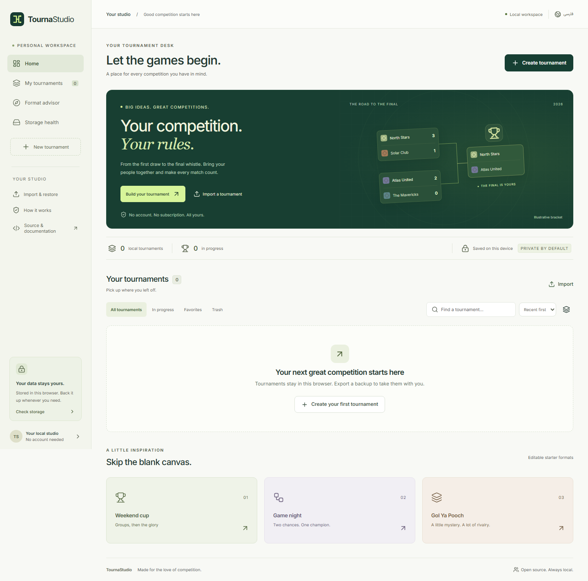
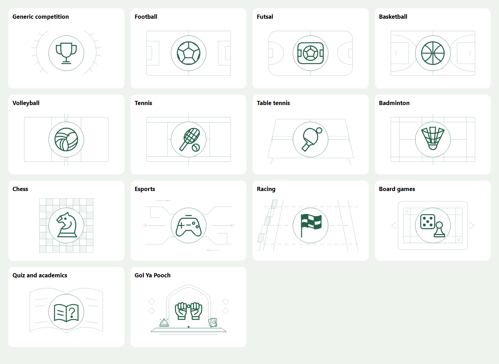
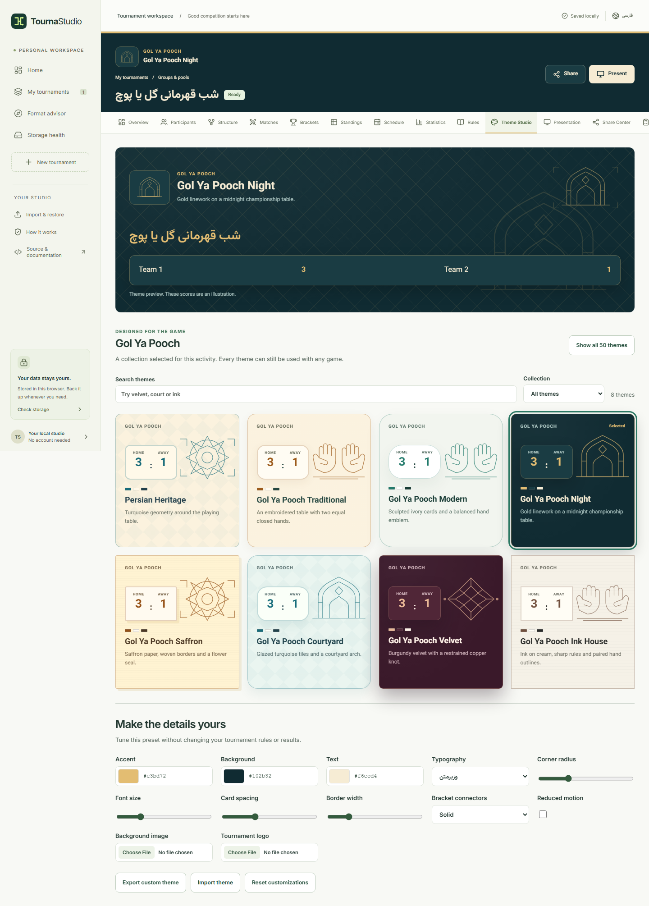

<p></p>

# TournaStudio

I built TournaStudio so a tournament can belong to the people running it. Open the app, make a draw, record results, and take the whole competition with you as a file. There is no account, subscription, or application server.

**[Open TournaStudio](https://tournamentstudio.github.io/)** · [User guide](USER_GUIDE.md) · [Feature status](FEATURES.md)

The October 29, 2026 updates improve English/Persian layout and add original
game artwork to exported scoreboards and champion posters. Long sponsor names
and overlay titles now fit their exported cards. Failed-save recovery survives
navigation attempts, and canceled imports cannot reopen a later preview.
Wildcard comparisons respect lower-is-better weighted scores; new ladder rounds
exclude withdrawn entrants. The earlier startup update cut initial JavaScript
transfer by about 46% in the recorded test. I also tested a complete Gol Ya Pooch
event, offline recovery and a 512-participant bracket with simulated CPU slowdown.
The
[release handoff](RELEASE_STATUS.md), [performance measurements](PERFORMANCE.md)
and [maintenance review](MAINTENANCE_AUDIT.md) record the checks and their limits.



The application is a static React and TypeScript bundle hosted on GitHub Pages. Tournament documents live in IndexedDB. After a successful initial cache, the app works offline. Every production font, icon, and library ships with the build.

## What you can run

- Single elimination with fields up to 512 entrants, automatic BYEs, full classification or third place, and safe result corrections.
- True double elimination with loser drop paths, a conditional grand-final reset and optional full classification.
- A documented progressive three-loss elimination policy.
- Round robin, balanced uneven groups, GSL groups of four, Swiss, and qualifying stages feeding playoffs.
- Multiple qualifying sources, exact cross-group bracket slots, and wildcard comparisons by totals, per-match values or retained group results.
- Seed pots for Groups and GSL, with previewed balanced draws and limits on entrants from the same region or organization.
- Knockout pot draws with region and organization separation through selected winners and losers rounds, protected seed positions, explicit qualifier slots, and a BYE preview.
- Independent grand-final, reset and third-place separation checks, with a preview that rejects impossible combinations before matches are generated.
- Minimum and maximum opponent distances using manually entered city or club coordinates, with independent round and final targets.
- Venue-distance limits for selected knockout matches, with saved venue assignments that scheduling preserves.
- Automatic venue proposals from a candidate pool, with all-path distance checks and an optional schedule preview before applying fixed assignments.
- Multi-entrant heats, weighted measurements and judge panels, time trials with split timers, Grand Prix points, gauntlets, challenge invitations and King of the Hill.
- Aggregate knockout ties with 2 to 8 legs, per-leg scheduling, optional regulation away-goal tiebreaks and recoverable corrections.
- Schedules with rest and availability checks, timeline editing, delay previews, bounded scheduling and venue-travel optimization, plus CSV and calendar export.
- Events and seasons with explicit shared identities, division movement, local Elo histories and portable prediction brackets.
- Predictions for static stages and generated dynamic rounds, including draws, loser paths, conditional resets and tied multi-entrant placements.
- Private roster-player observations, sport metric templates, reviewed corrections, player totals and CSV exports.

These are defined local rulesets. General Swiss offers constrained score-based pairing, manual review, side preferences, late-entry credits and fixed-group acceleration. A separate FIDE Dutch 2026 mode runs the locally compiled BBP engine, with fixed pairing numbers, joint opponent/color decisions and standard chess points. Its source, pinned correction and build instructions are included; TournaStudio has no independent FIDE endorsement. Acceleration in General Swiss adds temporary pairing points only. Three-loss elimination uses dynamic rounds. Ladders offer adjacent challenges, reviewed invitations or an incumbent queue. Exact policies and limits are in [ARCHITECTURE.md](ARCHITECTURE.md).

## At the tournament desk

Quick Create accepts numbered entrants or pasted names. The workspace includes participant rosters, local logo uploads, waiting lists, eligibility and payment-status records, participant availability, check-in, match control, standings, a stage graph, schedules, statistics, rules, themes, presentation, portable sharing, offline registration/result exchange, revision history, typed custom fields and vault settings.

English and Persian labels, local Inter and Vazirmatn fonts, and RTL layouts are included. The interface is designed for desktop and phones. Engine and import diagnostics have Persian display translations. Mobile navigation contains focus, routes identify the current page, and saved changes and public scoreboards have assistive announcements. [FEATURES.md](FEATURES.md) records supported behavior and platform boundaries.

Named personal designs complement 50 theme presets with game collections for all 14 activities. Original court diagrams, paddles, chess pieces, Persian geometry and other vector artwork sit on paper, wood, felt, tile and other material treatments. Theme Studio recommends related choices and lets you search the full catalog. The selected identity appears in creation, the workspace, match cards and scorekeeping.

Fourteen separate activity icons keep each game recognizable across theme changes, library covers and presentation screens. Gol Ya Pooch uses closed fists and a bead, with bell and card symbols in its referee controls. [Design references](DESIGN_REFERENCES.md) explain the Persian sources and original artwork.


Exported scoreboards and champion posters use original scenes for all fourteen
activities. Gol Ya Pooch has closed hands, a bead, a tabletop bell, cards and a
Persian arch. Mixed Persian and English names wrap within the exported image.



Presentation Studio has 21 scene types, playlists, keyboard controls, fullscreen, three aspect ratios and configurable broadcast overlays. Sponsor cards support grid, strip and spotlight layouts; overlay images can retain transparency. A second tab in the same browser profile reloads confirmed revisions. That is local communication, not synchronization across devices.

Gol Ya Pooch has a three-player default roster, quick scoring and a detailed referee desk. Configure target/margin or timed-period policies, persisted clocks, overtime and structured card effects before play. Public projections contain live totals but exclude hand logs, clock/possession state and concealed positions. Traditional, Modern, Night, Saffron, Courtyard, Velvet and Ink House themes also work in presentation mode. Both sides receive identical decorative emblems, independent of concealed gameplay information.



Events & seasons combines weighted placement awards across linked competitions, using explicit identity mappings. Reviewed division movement creates a new season without changing the previous one. Event packages include their competitions and private exports require encryption.

The Share Center recommends transports and can export multipart QR images. QR image decoding is local, and the camera starts only on request. Large lists use bounded pages; restricted draws run in cancelable workers with an explicit fallback when workers are unavailable.

Schedule includes a private offline route network. Enter known locations, link distances and durations, and map entrant homes and venues. The itinerary follows confirmed bookings, reports late or unknown arrivals, and exports CSV. It can choose shortest-distance or shortest-time paths within that entered network; no map, geocoder or traffic service is contacted.

## Run it locally

Use Node.js 22.12 or later and npm.

```sh
npm ci
npm run dev
```

The development server binds to `127.0.0.1`. No environment secrets or external services are required.

```sh
npm run typecheck
npm run lint
npm test
npm run test:release
npm run build
npx playwright install chromium firefox webkit
npm run test:e2e
```

Browser tests use the production bundle at port 4173. Run the build first. `playwright.config.ts` defines the Chromium, Firefox and WebKit projects. All validation runs locally; this repository has no CI workflow.

For a local production preview:

```sh
npm run preview -- --port 4173
```

## Keep and share your data

Confirmed writes create a new revision inside an IndexedDB transaction. The last 50 logical revisions use validated command deltas and periodic full checkpoints. Undo, Redo and History restore show a preview and create a new revision. Competing tabs use revision/hash checks, and a rejected save offers a recovery export. Trash is recoverable until explicitly purged.

Share Center offers:

- A public data-bearing snapshot link or `TS1` text code, including an optional `TSK1` embedded-key link whose holder can decrypt it.
- A full `.tourney` backup with optional saved revisions, encrypted together when a secret is selected.
- A `TSR1` single-stage or `TSR2` multi-stage recipe with structure and settings rather than names or results. Result-specific stage connections require a snapshot.
- A `TSP1` update packet with optional encryption, exact-base application, and an explicit review for divergent copies with a retained base.
- A `TSS1` signature around a portable packet, with encrypted signing-key backups and a local list of independently confirmed public keys. Verification still requires normal import review.
- Export Studio provides SVG/PNG scoreboards, standings and champion posters, standalone printable HTML, and slide archives with an offline viewer. Brackets, CSV, participant XLSX and calendar files are also available. PDF uses the browser's Save as PDF option.

Snapshot links carry their data in the URL fragment. An arbitrary local ID cannot retrieve another person's tournament. Recipients have independent copies, and distributed snapshots cannot be revoked. A read-only preview does not prevent copying.

Protected vaults use Web Crypto AES-GCM and PBKDF2-SHA-256 with 600,000 iterations and random salts/nonces. The secret stays in memory while unlocked. Protected tournament and event tabs lock after 15 inactive minutes by default; the timeout is configurable. Titles and private document fields are encrypted in storage. There is no password reset or remote recovery. Export an encrypted backup and keep its secret separately.

Browser storage can be lost through data clearing, eviction, private browsing, or device loss. Use Storage Health and export backups. Encryption cannot protect data from someone already using an unlocked session. Details are in [PRIVACY_AND_SECURITY.md](PRIVACY_AND_SECURITY.md) and [DATA_FORMAT.md](DATA_FORMAT.md).

## Deploy to GitHub Pages

I run tests and compile releases locally. GitHub Pages publishes the prepared files from `main/docs`; there are no repository Actions workflows. The `.nojekyll` file skips Jekyll. GitHub handles publication of those files, without running npm or the test suite.

```sh
npm run check
npm run test:release
npm run test:e2e
npm run pages:prepare
git add docs
```

Review and commit the source changes together with the prepared `docs` files, then push `main`. `pages:prepare` builds the app and copies only generated assets into `docs`. Its checksum manifest removes obsolete build assets while preserving documentation screenshots. It refuses to replace unrelated files or silently discard edits to previously published assets.

For a fork, choose **Settings > Pages > Build and deployment > Deploy from a branch**, then **main** and **/docs**. Repository administration permission is needed for that setting. There is no custom CI to enable.

`pages:prepare` derives `GITHUB_REPOSITORY` from the origin remote unless it is explicitly set. Repositories ending in `.github.io` use `/`; project repositories use `/<repository>/`. Hash routes keep refreshes and snapshot links compatible with static hosting. Share links derive their origin and path from the running app.

The service worker caches the application shell and bundled assets. It offers an update prompt and does not remove the tournament database. Local preview and GitHub Pages use separate browser storage because they have different origins.

## Project map

`src/domain` defines and validates data. `src/engine`, `src/scoring`, `src/standings`, and `src/scheduling` implement competition rules independently of React. `src/persistence` handles local transactions, `src/collections` manages events/seasons, `src/records` supplies ratings/predictions, `src/players` stores roster-player observations, and `src/timing` stores local run clocks. `src/security` and `src/sharing` handle untrusted imports and portable packages. `src/themes`, `src/presentation`, and `src/export` render public views. `src/app` connects these modules to the interface.

See [ARCHITECTURE.md](ARCHITECTURE.md) for contracts and [FEATURES.md](FEATURES.md) for the full status matrix.

## Practical boundaries

There is no hosted registration service, account system, payment processing, cloud storage, or cross-device live collaboration. Registration and scorekeeper responses are explicit file exchanges.

Federation-specific Swiss certification, automated game/video verification and certified timing are outside the supplied local policies. Accessibility checks and remaining human-device audit steps are documented in [ACCESSIBILITY.md](ACCESSIBILITY.md). A signature proves possession of a key; a separately checked fingerprint is needed to associate it with a person, and timestamps remain claims.

Venue rules reserve eligible entrants for match slots, including walkovers; they do not estimate actual trips. Public snapshots omit coordinates and private route data; private backups retain them. Affiliation protection for a grand final or reset requires distinct labels for all entrants because any pair can reach those matches. Distance protection requires every entrant pair to meet the selected interval. Geographic placement restrictions cover the third-place target; they do not constrain every match in a full classification tree. Counts are capped at 512 entrants and 20,000 matches per document. A 512-entrant round robin exceeds the match cap; the limit is not a promise that every format supports the same field size.

Modern Chromium, Firefox, and WebKit are the browser targets. PWA installation and persistent-storage permission vary by browser. A secure context is required for crypto and service workers; HTTPS and localhost qualify.

## Help shape the project

I welcome fixes, tournament rules with worked examples, Persian translation improvements, and reports from real events. Start with [CONTRIBUTING.md](CONTRIBUTING.md) for setup and local checks. The [issue forms](https://github.com/tournamentstudio/tournamentstudio.github.io/issues/new/choose) help capture a reproducible bug or a proposed rule change.

Use [Discussions](https://github.com/tournamentstudio/tournamentstudio.github.io/discussions) for questions and ideas. [SUPPORT.md](SUPPORT.md) covers common storage, backup and offline questions. Please keep private tournament files and recovery secrets out of public posts; use [SECURITY.md](SECURITY.md) to report a vulnerability privately.

The [brand kit](public/brand/README.md) contains the logo, wordmark and social image, with editable vector sources.

## License

The application is MIT licensed. See [LICENSE](LICENSE). Bundled fonts use the SIL Open Font License. Dependency acknowledgments are in [THIRD_PARTY_NOTICES.md](THIRD_PARTY_NOTICES.md).
