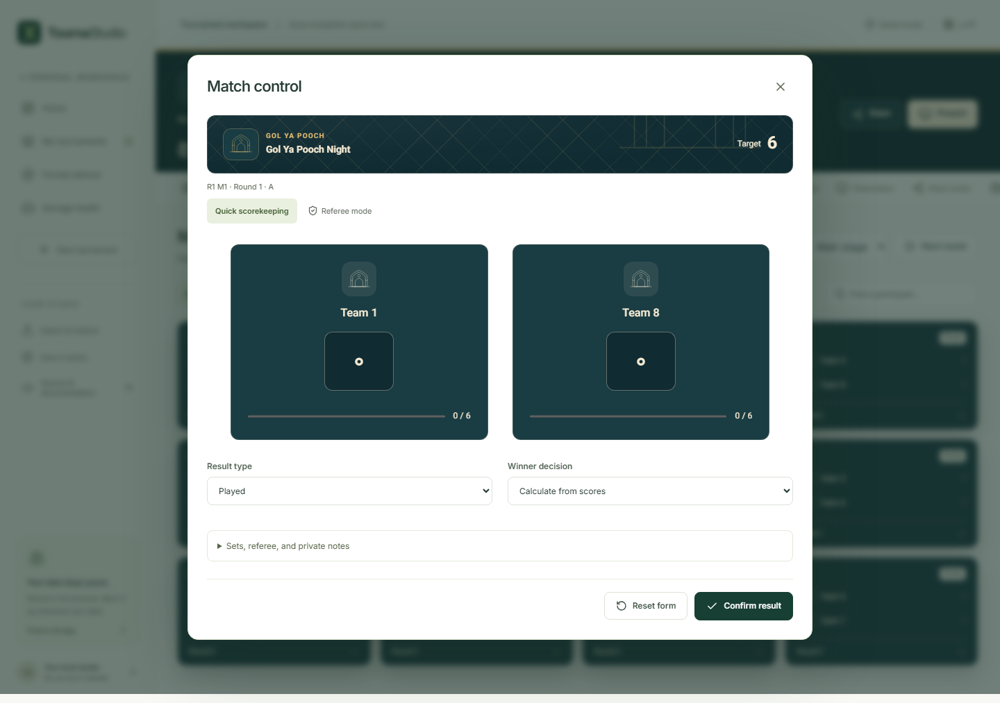

# Using TournaStudio

TournaStudio keeps tournaments in the browser you are using. You can create,
score, present and export a competition without an account. Keep a `.tourney`
backup outside the browser if the results matter: clearing browser data or
losing a device can remove local access.

## Create your first tournament

1. Choose **Create tournament** on the home screen.
2. Enter a title and choose a sport or activity. A sport sets starting rules;
   it does not limit the whole competition to that sport.
3. Choose a format. Enter a participant count, or paste one name per line.
   A pasted list takes precedence over the count. Duplicate names need
   correction before creation.
4. Choose a theme. If you want encrypted local storage, enable the protected
   vault and enter a secret you can keep.
5. Choose **Create tournament**. The draw appears in the workspace and is
   saved to this browser.

Enable **Show advanced configuration** in the first step to choose a
reproducible random draw and its seed. Numbered entrants are suitable while you
are planning; rename them in Participants before play.

Format Advisor compares single elimination, double elimination, round robin
and Swiss using your time and playing-resource estimates. Its finish times are
lower bounds. Rest, availability, unresolved results and qualification dependencies
can extend an event. **Open builder** opens the creation flow; select your chosen
format there.

## Find and organize local tournaments

Use **My tournaments** to search names, switch between grid and list views, sort
by recent activity or name, and filter favorites, in-progress tournaments or
trash. Sport and format filters narrow the list further. The action menu on a
card can duplicate, favorite or move it to trash.

Duplicates have a new tournament identity and are independent copies. Moving a
tournament to trash is reversible. **Delete forever** is a separate confirmed
action available in trash.

To mark a competition completed or archived, open its **Settings** and choose an
allowed status transition. Status changes and the competition's actual recorded
results are separate: use the bracket and standings to check whether play is
finished.

## Add and edit participants

In **Participants**, choose **Add entrants** and paste one name per line.
**Import list** accepts TXT, quoted multiline CSV, JSON participant objects and
the first worksheet of an XLSX file. Review the names and correct duplicates
before confirming. Spreadsheet formulas must be replaced with values.

Choose **Edit** beside an entrant to change its name, seed, region, organization or
active/withdrawn/disqualified status. Team rosters can contain players, a captain,
substitutes and coaches. The check-in checkbox records attendance; CSV and
**Print check-in** provide portable sheets.

Adding a participant does not silently redraw an existing stage. Before any
results are recorded, open **Structure**, choose the stage and confirm **Reset
unplayed draw**. Select **Refresh entrant list**, then **Generate draw**. The
refresh action is available for a stage with directly assigned participants.
Stages fed by qualification connections resolve their own entrants. Once play
starts, keep the current draw or duplicate the tournament to redesign it.

## Choose and operate a format

| Format                 | How play proceeds                                                                                                                                                                          |
| ---------------------- | ------------------------------------------------------------------------------------------------------------------------------------------------------------------------------------------ |
| Single elimination     | Enter each ready result; winners advance automatically. BYEs advance without a played result.                                                                                              |
| Double elimination     | The first defeat sends an entrant to the lower bracket. With final reset enabled, a lower-bracket win in the first grand final creates the deciding reset match.                           |
| Three-loss elimination | Complete the current round, then generate the next round. Three losses eliminate an entrant under TournaStudio's published policy.                                                         |
| Round robin            | Play the generated meetings. An odd field rotates the entrant without a match. Configure points and tie-breakers in Rules.                                                                 |
| Groups                 | Complete each pool's matches, then use group standings to qualify entrants into a destination stage.                                                                                       |
| GSL                    | Each group must have four entrants. The winners-match winner and decider winner take the two qualifying positions.                                                                         |
| Swiss                  | Complete the current round, then choose **Advance / next round**. The engine avoids repeat opponents and repeated BYEs. A pairing failure is reported, not replaced with a hidden rematch. |
| Free-for-all           | Enter scores for every entrant in each heat. Placement points accumulate over configured rounds.                                                                                           |
| Gauntlet               | Lower seeds start; a winner meets the next higher seed.                                                                                                                                    |
| Challenge ladder       | Complete adjacent challenges and advance to the next round. Successful challengers move in the ladder.                                                                                     |
| Time trial             | Use one consistent numeric time unit for all entrants; lower scores win. Standings use configured placement points.                                                                        |
| Grand Prix             | Record each event and accumulate placement points across the configured rounds.                                                                                                            |

The normal creation range is 2 to 512 entrants. Standalone round robin supports
up to 128. GSL needs a multiple of four. More entrants and more repeated meetings
can reach the 20,000-match document limit. These are capacity limits, not a
promise of the same rendering speed on every device.

## Draw groups from pots

Pot draws work with **Groups & pools** and **GSL groups**. For eighteen teams
in four groups, the balanced group sizes are five, five, four and four.
See the [pot draw preview](docs/screenshots/pot-draw-preview.png) for an example.

1. Enter each team's **Region** and **Organization** in Participants if you want
   those restrictions. Use consistent labels. For example, do not mix a country
   abbreviation with its full name.
2. In **Structure**, select the group stage. If an unplayed draw already exists,
   confirm **Reset unplayed draw** first. Played matches cannot be redrawn here.
3. Choose **Configure pot draw**, then **Fill pots by seed**. This puts the
   highest seeds in the first pot, with at most four teams per pot for four
   groups. You can rename pots, add or remove them, and change each entrant's pot.
4. Enable **Limit entrants from the same region** or **Limit entrants from the
   same organization**, and set the maximum allowed in one group. Both limits
   can apply together. Remove all pots to use restrictions alone.
5. Choose **Preview group draw**. Inspect the proposed groups and any reported
   errors, then **Apply draw rules**.
6. Choose **Generate draw** to create matches. The saved seed and rules reproduce
   the preview. Changing a seed requires discarding or applying the current
   rule draft first.

Every entrant must belong to exactly one pot when pots are used. No group
receives two entrants from the same pot. An incomplete pot assignment, missing
affiliation or impossible combination blocks the draw. A search-limit message
means the app has not established whether a solution exists; it does not prove
that the draw is impossible. Try another seed, revise the agreed restrictions,
or split a large stage. The app never changes restrictions on its own.

If entrants arrive from earlier stages, complete those stages and resolve
qualification before assigning pots. A different tab changing the stage
invalidates an unsaved draft. Discard that draft to start from the latest saved
rules. Exported tournament files retain pots and restrictions; recipes create
new unnamed entrants, so fill their regions and organizations before drawing.

## Restrict knockout pairings

Single and double elimination support pot, region and organization restrictions.
Pots separate entrants in the first round. Region and organization restrictions
can extend through a chosen winners-bracket round. Double elimination also has
independent losers-bracket rules. Grand finals, resets and third-place matches
have separate controls; protecting an earlier round does not protect these matches.
Distance rules use coordinates independently of region and organization labels.
See the [knockout preview](docs/screenshots/knockout-draw-preview.png) for a
thirteen-entrant draw with three BYEs and two protected positions.

1. Enter consistent **Region** and **Organization** values in **Participants**
   for any restriction you intend to use.
2. In **Structure**, select the knockout stage. Reset an existing unplayed draw
   first. Played matches remain protected.
3. Choose **Configure knockout draw**. Use **Fill pots by seed** or assign pots
   manually. Every entrant needs exactly one pot when pots are enabled. Remove
   all pots to use affiliation restrictions alone.
4. Enable **Separate the same region** or **Separate the same organization**.
   Both can apply together. Set **Separate regions through round** and
   **Separate organizations through round** for each enabled rule. Round 1 keeps
   the original opening-round behavior; higher numbers protect later rounds.
5. Set **Protected seed positions** to pin a leading count at their standard
   bracket positions. Leave it at zero to let all unpinned entrants move.
6. Choose **Preview knockout draw**. Review every pair, slot, BYE and fixed
   position. For later-round rules, also inspect the protected sections:
   each section can contain only one entrant with a given restricted label.
   Then choose **Apply draw rules** and **Generate draw**.

For a sixteen-slot winners bracket:

| Protect through        | Earliest possible meeting         | Maximum entrants with one label |
| ---------------------- | --------------------------------- | ------------------------------- |
| Round 2, quarterfinals | Round 3, semifinals               | 4                               |
| Round 3, semifinals    | Round 4, final                    | 2                               |
| Round 4, final         | No meeting in the winners bracket | 1                               |

The rule holds for every possible match result. A BYE still occupies a bracket
position and counts toward these limits. Region and organization may use
different round limits. Labels are compared after normalization, so common
Persian/Arabic letter forms and extra spaces do not bypass a restriction.
Country codes and full country names are not automatically treated as aliases.
See the [protected-section preview](docs/screenshots/knockout-separation.png)
for a draw that separates regions through round 2 and organizations through round 3.

A thirteen-entrant bracket needs sixteen slots and three BYEs. Those BYEs go to
the first three entrants in the selected draw order. Ranked seeding uses seeds,
manual ordering uses the stage's entrant order, and random seeding randomizes
the order. Entrants from source stages use their qualification order unless
random seeding is selected. The same order determines protected seed positions.
The app does not add BYEs to avoid difficult pairings.

Fixed qualifier slots from stage connections are retained. A conflict with a
protected position, a BYE recipient or a separation rule blocks the
draw. Review the source mapping, selected order or agreed rules. A search-limit
message means feasibility is still unknown; it is not a proof of impossibility.
The app never relaxes restrictions automatically.
Rules are checked when previewing and generating. Editing an affiliation after
the draw does not move saved matches. If the agreed categories change, reset an
unplayed draw and preview it again; keep played results intact.

To return to standard drawing, choose **Use standard draw**, preview it and apply
the change. This also allows switching to formats outside single/double
elimination. Saved files and snapshot links retain knockout rules. Recipes
retain the structure but require new affiliation values before restricted draws.
Later winners rules use version 2; losers rules use version 3; final and
third-place rules use version 4; distance rules use version 5. Recipients need
an app release that supports the saved version before importing the tournament.

### Protect the losers bracket

In a double-elimination stage, use **Losers bracket separation**. Set **Separate
regions through losers round** or **Separate organizations through losers round**
to the last round you want protected. Use **Off** to disable a field. These
settings do not require a winners-bracket restriction for the same field.
The [verified lower-round preview](docs/screenshots/knockout-losers.png) shows
the protected rounds for each field before you apply the draw.

Lower rounds follow the displayed bracket, including rounds containing BYEs.
An eight-slot draw has four lower rounds. A two-entrant draw has no lower rounds.
The preview checks the actual drop paths for every possible result, then either
provides a valid draw or explains why it cannot supply one. It never changes the
drop paths during play.

Winners and losers restrictions can conflict. For example, in a full eight-team
draw, two entrants who start against each other can avoid a lower-bracket meeting
until lower round 3. Preventing that opening match as well can make protection
through lower round 2 impossible. Try a less restrictive lower round or revise
the agreed winners rules. Pot assignments and fixed qualifier positions also
constrain the available draw.

BYE recipients have no first-round defeat and cannot enter through that drop.
The preview accounts for this rather than inventing an opponent. The last lower
round can only be protected when every entrant has a different restricted label.
Changing affiliations after generation does not rearrange saved matches.

To return to single elimination, remove the losers rules and any grand-final or
reset rules, preview the change and apply it first. Reset an existing unplayed
draw before editing its rules; played matches remain locked.

### Protect finals and third place

In **Structure > Configure knockout draw**, open **Finals and placement
separation**. Each available match has independent region and organization
checkboxes. Enable the stage's **Third-place match** or **Double elimination
final reset** setting first if you want to protect that optional match.
Then preview, review **Verified finals and placement protection**, and apply.
The [final protection preview](docs/screenshots/knockout-finals.png) lists each
selected match and protected field separately.

For double elimination, **Grand final** and **Reset final** each require distinct
labels for every entrant in the selected field. Any two entrants can become the
finalists, even if they meet in the opening round. Moving seeds cannot guarantee
a different region in the final when two entrants share that region. The preview
reports the duplicate and blocks the draw. Choose a different agreed rule or
remove that final target; the app never replaces a rightful finalist. Reset
protection matters only if the reset is played.

Single elimination offers **Third-place match** protection. The draw keeps
matching affiliations in the same half so they cannot both lose opposite
semifinals. This can require an earlier meeting in the winners bracket. For
example, in an eight-team bracket, two entrants from one region can occupy the
same half but different opening matches. Requiring that region to stay separated
through the semifinals as well makes those two rules incompatible. The preview
checks both rules together with pots, fixed positions and BYE recipients.

With three entrants, a semifinal BYE has no loser and the third-place match has
only one entrant. The editor explains that no pair can meet there. A two-entrant
stage has no third-place match to protect. Other placement brackets are not
available.

Remove a target, preview and apply before disabling its match setting or changing
to an incompatible format. Removing all final targets keeps any winners/losers
rules and restores the appropriate earlier rule version. Saved draws and played
results keep their paths. Exported snapshots, backups and update packets retain
these settings; recipients need a release with version 4 knockout-rule support.

### Restrict opponent distances

Use **Geographic distance** when entrants' base locations matter more than shared
region labels. A minimum distance keeps nearby entrants apart. A maximum distance
limits how far apart paired entrants may be. The app compares the shortest arc
between those bases on a sphere, so these values are estimates, not road distances
or travel times. It does not optimize the total travel of the tournament.

1. Open **Participants**, edit an entrant and choose **Add base location**.
   Enter **Latitude** from -90 to 90 and **Longitude** from -180 to 180 in decimal
   degrees. Use a city center or club base rather than a home address. Choose
   **Save participant**. Repeat for every active entrant in the stage, including
   BYE recipients. No device-location permission or online address lookup is used.
2. In **Structure**, open **Configure knockout draw**, then **Geographic distance**
   and **Add distance restriction**. Reset an existing unplayed draw first.
3. Set **Minimum opponent distance (km)**, **Maximum opponent distance (km)**,
   or both. Leave a bound blank to omit it. Zero is a real bound: maximum zero
   permits only identical base locations. Limits are inclusive, and minimum
   cannot exceed maximum. The allowed input range is 0 to 20016 km.
4. Choose **Apply distance through winners round** and, for double elimination,
   **Apply distance through losers round**. **Off** disables that bracket range.
   Each selected range starts at round 1. You may also select the grand final,
   enabled reset or single-elimination third-place match. Choose at least one
   target; the same interval applies to all selected targets.
5. Preview the draw. **Verified distance range** lists the limits and targets.
   The opening-pair preview shows rounded distances; validation uses full numeric
   precision. Inspect BYEs, protected positions and any other rules, then choose
   **Apply draw rules** and **Generate draw**.

See the [verified distance preview](docs/screenshots/knockout-distance.png)
for an example covering winners, losers and both final matches.

For example, a 100 to 900 km opening-round range requires every played opening
pair to be at least 100 km apart and at most 900 km apart. BYEs have no opponent.
Extending protection through later rounds checks every possible opponent path,
not just predicted winners. Any two entrants can reach a grand final or reset,
so protecting either match requires every pair in the field to meet the interval.
A conflict is reported before drawing; the app never removes an earned finalist
or weakens a rule. Pots, affiliations and fixed slots may also make a range
impossible. A search-limit message means feasibility is unknown.

Changing coordinates does not rearrange saved matches. Reset an unplayed stage
and preview again if the agreed bases change. **Remove distance restriction**
keeps the remaining affiliation rules. Preview and apply before changing a
format or disabling an optional match protected by a saved distance target.

Public links, public updates and recipes omit coordinates. Public copies can
show and score saved matches, but need new base locations before regenerating
a distance-restricted draw. Use a private snapshot or `.tourney` backup to carry
coordinates to another device; encrypt confidential packages. The names-only
participant-list importer does not import coordinates. Full tournament JSON and
private archives preserve them. **Remove base location**, followed by saving the
participant, clears that entrant's stored coordinates.

### Assign venues with distance limits

Use **Venue distance** to assign a court, table or room to specific knockout
matches and limit the distance from entrants' bases to that venue. Each selected
match reserves a venue for every entrant who could reach its slots. The policy
includes automatic advances and walkovers, even when no match is played. It
does not estimate actual trips. You can assign venues manually or use the
automatic selection assistant described below.

1. In **Schedule**, add the courts, tables or rooms you need. Under each resource,
   choose **Add venue location** and enter its latitude and longitude in decimal
   degrees. Choose **Save schedule settings**. Both coordinates are required
   when location entry is enabled. A resource already used by a draw or saved
   match cannot be removed while that reference remains.
2. Enter each active participant's base coordinates in **Participants**.
3. In **Structure**, reset an unplayed draw if necessary, open **Configure knockout
   draw**, then choose **Add venue restriction** under **Venue distance**.
4. Select a venue, enter a minimum distance, maximum distance, or both, and select
   its match targets. Choose a bracket round to find the desired matches. A match
   can belong to only one venue rule. Finals, enabled resets and third-place
   matches are also available for their supported formats.
5. Preview the draw, inspect **Verified venue assignments**, apply the rules and
   generate the draw. The engine keeps pots, seed protection, BYE recipients,
   affiliation rules and opponent-distance rules active together. An impossible
   combination produces an error; search exhaustion means feasibility is unknown.
6. Generate the schedule. Selected matches keep their venue and its availability
   window. Their resource selector is locked in the schedule table. To change a
   venue rule, reset an unplayed stage and revise its draw rules. Played results
   are never removed by changing a resource coordinate.

See the [verified venue preview](docs/screenshots/knockout-venue.png) for two
regional venues assigned to separate knockout matches.

For example, give two quarterfinal matches a western venue and the other two an
eastern venue, each with a 500 km maximum. Each quarterfinal can contain only
entrants eligible for its assigned venue. Later matches need their own targets
if their venues should also be restricted. A final normally needs a venue that
every entrant can reach within its limits. A smaller bound cannot be repaired by
changing seeds when all entrants could reach that final.

Bounds use the same spherical calculation as opponent distances. Both endpoints
are included, zero is valid, and blank means no bound on that side. The range is
0 to 20016 km. Different venue rules can have different bounds. No road distances,
travel times or total travel budgets are calculated.

Changing a participant or venue coordinate does not move saved matches. Schedule
conflicts report any broken venue rule, and automatic scheduling refuses to use
invalid distances. Checks retain the original possible paths even after results
are recorded, so an eliminated entrant is not silently exempted from the saved
rule. Edits from another tab invalidate an open draw or schedule draft; reload
the confirmed settings before applying further changes.

Public snapshots retain venue names, rules and assignments, but omit entrant and
venue coordinates. Private archives preserve them. Recipes create numbered venue
placeholders and need new coordinates. Venue rules use version 6; update older
copies of the app before importing these rules.

### Let the assistant choose venues

After entering entrant and venue coordinates, open **Automatic venue selection**
in the knockout draw editor:

1. Choose up to sixteen candidate venues and the unassigned match positions to
   fill. You can select opening rounds, later rounds, losers brackets, finals,
   resets or third place where the format supports them.
2. Enter a minimum distance, maximum distance, or both. The same bounds apply to
   this selection. Existing manual venue rules keep their own bounds.
3. Leave **Check schedule availability** enabled to test a fresh schedule on a
   temporary copy. This reschedules all generated matches for the check. It does
   not reserve existing saved times, and it does not save any times or results.
4. Choose **Find venue assignments**. Review the chosen venues, possible entrants,
   distance ranges and opening pairings. If a schedule was found, its displayed
   start, end and match count describe the selected stage only.
5. Choose **Add suggestions to draw draft**, preview the knockout draw, apply its
   rules, then generate the draw. Generate the schedule separately when ready.

The assistant prefers smaller farthest-base distances among the candidates it
checks. It may change the draw to find a valid assignment while retaining seeds,
pots, qualifier positions and existing restrictions. It does not minimize total
travel, and a venue may host several matches at different times. Selections
become fixed venue rules; they are not automatically changed as results arrive.

Search has fixed work limits. If it reaches one, feasibility is unknown. Try
fewer matches or venues, or assign some matches manually. A failed schedule check
means the greedy scheduler found no witness, not that every schedule is impossible.
Other stages and their availability settings can affect the check. Changing the
document or assistant inputs invalidates an old proposal. A stage with generated
matches must be reset through the existing result-protection workflow first.

See an [automatic venue proposal](docs/screenshots/automatic-venue.png) and its
[Persian mobile view](docs/screenshots/automatic-venue-persian.png).

## Build groups followed by playoffs

For sixteen teams in four groups:

1. Create a **Groups & pools** tournament with sixteen entrants and four groups.
2. Open **Structure** and choose **Add stage**.
3. Name the new stage and choose **Single elimination** in **Stage settings**.
   Choose the group stage under **New connection source**, then **Add connection**.
4. Set **Qualifiers to take 1** to `2`, enable **From each group**, and choose
   **Apply connections**.
5. Complete the group results.
6. Select the playoff stage and choose **Generate draw** or
   **Advance / next round**. Eight qualifiers enter the bracket.
7. Record playoff results through the final.

You can use the same source-stage controls for Swiss to knockout or a league
followed by playoffs. The source must be complete. If entrants tie at the
qualification cutoff, the application refuses automatic advancement. Apply an
agreed tie-break rule in **Rules** and inspect the standings before continuing.
Do not add seed as a ranking rule merely to disguise an unresolved sporting tie.

The graph shows connections and allows stage selection, zoom and panning. Drag
the dotted handle to move a stage, or focus the handle and use arrow keys. Drag
from an output port to an input port to start a connection. The form below the
canvas provides the same connection controls without dragging. Inspector arrows
change the stage order independently of its canvas position.

Connections stay in a draft until you choose **Apply connections**. Review the
qualification preview first. A stage with a generated draw, or a generated
descendant, locks its inputs to protect the existing competition.

### Set exact cross-group matchups

Select the destination stage and edit its connection:

1. Set **Qualification rule** to **Exact group / rank positions**.
2. Choose Group A, rank 1. Use **Add position** for Group B, rank 2.
3. Enter `1, 2` in **First-round bracket slots**.
4. Add another connection for B1 and A2, using slots `3, 4`.
5. Choose **Apply connections**. Once the source is complete, generate the draw.

Slots are physical first-round positions: 1 plays 2, then 3 plays 4. They are
available for single and double elimination. Leave slots blank for normal seeded
placement. A slot cannot be occupied twice. You can combine qualifiers from
several source stages by adding more connections.

### Compare wildcards from uneven groups

For eighteen teams in four groups, decide the comparison policy before play.
Five-team groups provide more matches than four-team groups.

1. Add a direct connection for group winners or any other guaranteed places.
2. Add another connection with **Wildcard across groups**.
3. Set **Candidate rank**, the number of **Qualifiers to take**, and the groups
   to compare. Rank 2 selects runner-up candidates; rank 3 selects third places.
4. Choose a comparison: **Total statistics**, **Statistics per match**, or
   **Discard results against bottom teams**.
5. Set the ordered wildcard tie-break criteria. The preview shows original and
   compared values, selection reasons, and the number of matches compared.
6. Choose **Apply connections**, finish the source, then generate the destination.

Per-match comparison divides the selected statistics by played matches.
Discard-bottom comparison removes games against the lowest places in larger
groups until the retained group sizes match. It does not change the original
group standings or the candidate's source rank. Direct qualifiers are excluded
before wildcard selection, even when the wildcard connection is listed first.

An unresolved source position, discard boundary or cutoff tie blocks the draw.
Choose and apply the event's agreed tie-break rules before continuing. Adding
seed as a criterion is an explicit sporting decision, not an automatic fallback.
Wildcards currently require a round-robin groups source; GSL uses its defined
qualification positions.

Use **Run simulation** to inspect a separate synthetic competition. Simulation
results are not saved into the real tournament.

## Record and correct results

Open a match from **Matches** or select its bracket card. Enter one score for
every entrant. Choose a result type; use an explicit winner for a forfeit,
walkover, no-show or other manual ruling.

For a best-of match, open **Sets, referee, and private notes** and enter one set
per line, such as `21:18`. Set scores must produce the required number of set
wins. Extra sets after the match was won are rejected. For a time-based result,
use the same unit for every entrant.

Choose **Confirm result**. The engine validates the result, updates dependent
slots and recalculates standings. Check the saved indicator before closing
the browser or changing devices.

To correct a completed match, open it again and edit the scores. If later played
or live matches depend on it, review the listed consequences. You can keep the
current result or explicitly confirm the correction and reset those dependents.
The previous saved revision remains in **History**. Corrections can also return
derived stages to draft or remove later dynamically paired rounds.

**Reset form** discards the score-form changes; it is not a tournament-wide undo.
To recover an earlier saved document, use **History**, choose a revision, and
confirm **Restore**. Restoration creates a new revision. The latest fifty local
snapshots are retained, so export important older revisions.

## Configure rules and understand standings

**Rules** contains scoring mode, odd best-of count, win/draw/loss points,
placement-point table and standings criteria. A numeric score is not always
a goal total: it can be points, set wins or an agreed elapsed-time unit.

Available tie-breakers include points, wins, score difference, scored,
head-to-head, Buchholz, Median Buchholz, Sonneborn-Berger and optional seed.
An asterisk in standings marks an unresolved tie. Equal ranks are preserved when
the selected sporting criteria cannot separate entrants.

Changing points after play has started recalculates standings. Existing match
winners remain recorded decisions. Review any effect on later qualification.

The statistics screen uses recorded results and excludes BYEs from played-match
totals. It does not estimate missing scores or create player statistics that were
never entered.

## Run Gol Ya Pooch

1. Start with **Gol Ya Pooch** as the sport. For eight teams and semifinals,
   choose two groups of four, then add a knockout stage taking two teams per group.
2. In **Participants**, enter the team names and their player rosters. Three
   players per team is the default rule; actual roster names are entered manually.
3. In **Rules**, agree on the target score, hand points, team size and any special
   cards before play. A card has a name, use limit and point adjustment. The app
   does not assume one disputed rule variant.
4. Open a match. Use **Quick scorekeeping** for totals or **Referee mode** for
   hand-by-hand recording.
5. In referee mode, choose the concealing team and the team receiving points.
   An optional concealed-position value is private. Choose **Record hand** to
   save the hand and publish only its updated score totals.
6. Use **Switch possession** when the game changes hands. Use the card selector
   when an agreed card applies. Card limits are checked per awarded team.
7. Correct a hand with **Undo** before the official result is confirmed.
   Finish with **Confirm result** to advance the winner.

The referee timer starts and pauses in the open dialog and resets when the dialog
closes. The target score is a configurable reference; it does not automatically
end a match. The organizer makes overtime and other special rulings according to
the agreed rules. After result confirmation, the hand log is locked; correct the
official score through quick scorekeeping.

Public links, presentation views and generated public graphics exclude the
concealed position, hand log and private notes. A **complete private backup**
intentionally contains referee information. Never distribute one as a spectator
package. **Theme Studio** offers Traditional, Modern, Night, Saffron, Courtyard,
Velvet and Ink House, along with Persian Heritage. The selection changes the
workspace, scorecards and event screen. The quick scorekeeper shows progress
toward the configured target without automatically ending a match. Decorative
emblems are identical for both sides and never indicate the concealed position.

## Schedule the event

In **Schedule**, set a start time, match duration and rest period. Add named courts,
tables or rooms and their availability windows. Start-time entry uses the device
timezone; the tournament has a separate display timezone in Settings.

Choose **Generate schedule**. Unknown future opponents are reserved
conservatively, so a schedule can be longer than the simple playing-time estimate.
After results resolve entrants, regenerating may free unnecessary reservations.

Edit match times, resource assignments and referees directly in the table.
Review conflict notices after manual changes. Use **CSV** or **Calendar file**
to export. Dynamic rounds must exist before they can be scheduled; a duration
estimate does not predict all later Swiss or ladder matches.

## Change the appearance

Open **Theme Studio** to see choices related to your game. Every activity has at
least two choices; there are fifty presets in total. Search by name or material,
or choose **Show all 50 themes** to explore other games and general styles.
You can still apply any theme to any activity.

Quick Create also offers game-specific suggestions with a live preview. Theme
changes affect the workspace header, match cards, scorekeeper, brackets and
presentation screens. Preview scores are explicitly illustrative; changing a
theme does not change the competition's actual results.

Adjust colors, font, size, spacing, corners, borders and bracket connectors.
The editor warns when custom text and background colors have low contrast.
Upload a tournament logo or background as PNG, JPEG or WebP. Files must be
under 2 MB and 16 megapixels. The app decodes and re-encodes them, reducing the
image if needed to fit the embedded-asset limit. SVG and remote image URLs are
not accepted.

**Export custom theme** saves a versioned JSON file you can import into another
tournament. **Reset customizations** restores the chosen preset; **Remove
images** removes the uploaded logo and background. There is no separate custom
theme library, so keep exported theme files for reuse.

## Present on a projector or a second screen

In **Presentation**, build a playlist of scenes. Add a scene, edit its duration
and public text, and use the up/down buttons to reorder it. Choose 16:9, 4:3 or
portrait, automatic rotation and fade or no transition. Sponsor names and every
scene's text are public content.

Choose **Preview presentation** to check the result. During playback:

| Control                    | Action                              |
| -------------------------- | ----------------------------------- |
| Left/right arrow           | Previous/next scene                 |
| Space                      | Pause or resume rotation            |
| Escape / Exit presentation | Return to the organizer interface   |
| Fullscreen                 | Ask the browser to fill the display |

For a separate display, use the tournament's presentation action to open its
same-origin display route in another tab or window, then move it to the projector.
Keep the same browser profile. Confirmed saves notify that display, which loads
the saved revision. Unlock a protected tournament separately in each tab; the
password is not broadcast.

Countdown text is a duration in seconds. A countdown restarts when entering its
scene. Champion and podium scenes wait for the deciding stage to finish. A group
stage alone does not invent an overall champion; a bronze place is displayed only
when a result supplies it.

For OBS, capture the browser window. An OBS browser source is a different browser
environment and does not automatically share this browser's IndexedDB. There is
no transparent overlay editor or cross-device live synchronization.

## Export graphics and backups

Open **Share Center**:

- **SVG** exports a bracket that stays sharp when enlarged.
- **PNG** exports a raster bracket with bounded dimensions. Prefer SVG for a
  large competition.
- **PDF / Print** opens a print-friendly schedule and bracket. Select your
  browser's Save as PDF destination if available.
- **CSV** exports match data.
- **Calendar** exports scheduled matches as an ICS file.
- **JSON** exports the public document.
- **Download private backup** exports the complete current `.tourney` archive.

A private backup includes the current document, embedded images, theme and audit
entries. It does not contain all fifty historical snapshots. Export an individual
older snapshot from **History** when you need to retain it.

For a protected local tournament, the backup uses its vault secret unless you
explicitly select a separate sharing secret. Keep that secret outside the file
and remember which one you used.

## Share across browsers or devices

1. Open **Share Center** and keep **Public spectator view** selected for viewers.
2. Choose plain sharing or **Encrypt with a separate secret**.
3. Choose **Generate link & code**.
4. Copy the link, copy the `TS1` code, or save its text file.
5. The recipient opens the link or uses **Import** to paste the code.
6. They inspect the read-only preview and choose **Save local copy** or
   **Fork with new identity**.

The link and code contain the actual data. A recipient does not need access to
your browser. Each saved copy is independent: edits in one browser do not update
another. Read-only preview does not prevent a recipient from keeping a copy.
Shared copies cannot be remotely revoked.

A saved copy keeps the tournament identity, which is needed for later update
packets. A fork gets a new identity and cannot accept the organizer's updates.
Do not fork a spectator copy if you intend to apply those updates.

If the code is large, use a `.tourney` file. The Share Center warns about long
links and only generates a QR when its payload is short enough. Most larger
tournaments will not fit the QR limit. Scan supported QR links with the device's
camera; the app does not include a camera scanner.

With encryption, send the secret separately. Anyone with both the full payload
and the secret can read it. Encryption does not prove who sent the package.

## Share a recipe

**Create recipe** creates a `TSR2` code with all stages, their connections, sport,
rules and appearance defaults. Names, results, private notes, coordinates and
uploaded images are omitted. Importing it creates numbered entrants and a new
tournament. Older `TSR1` single-stage recipes still import. A destination stage
can be drawn after its source results are ready.

## Apply later results with update packets

The organizer and recipient must agree on the recipient's exact base revision
and whether its snapshot was public or private.

1. The organizer keeps the original saved revision in History.
2. After recording more results, open **Share Center** and set **Recipient base
   revision** and **Recipient snapshot type**.
3. Choose **Generate update code** and send the `TSP1` code or its text file.
4. The recipient opens the matching tournament first, then opens **Import**.
5. Paste the update, inspect the resulting bracket and choose **Apply verified
   update**.

The app checks identity, exact revision and content hash before applying changes.
A wrong snapshot scope, truncated packet or duplicate update is rejected.
It does not silently overwrite local results.

If copies diverged, review the base, local and incoming values and select the
changes to retain. Preview the bracket before applying them. Blocked structural
changes can be saved as the sender's separate fork. Corrections affecting played
matches need explicit confirmation.
If the old base has aged out of the fifty-revision local history, send a fresh
full snapshot.

Private update packets may contain referee information. Select update encryption
and share its secret separately when the transfer needs confidentiality.

## Exchange registrations without a server

In the organizer's **Offline exchange** tab:

1. Add registration questions, choose text/number/yes-or-no/choice answers and
   mark required fields.
2. Choose **Export registration form**. The original form is also saved locally.
3. Give that JSON file to entrants through your own communication channel.

A recipient opens **Offline exchange** in any local tournament workspace, imports
the form, enters one participant or team name per line, answers its questions and
downloads the completed response. The response stays linked to the organizer's
tournament even if filled from another local workspace.

The organizer imports the response into the original tournament, reviews names
and answers, then chooses **Approve registration**. Duplicate names, IDs and
responses are rejected. New entrants join the participant directory and undrawn
root stages; an existing draw remains intact. Add actual roster members in
Participants as needed.

If the original form was lost from local metadata, import its saved form file
into the original tournament and choose **Register original form** before
approving responses. The app does not verify the sender's identity.

## Accept a scorekeeper's proposal

A scorekeeper with a matching tournament snapshot opens **Offline exchange**,
selects a match and enters proposed scores, set pairs, an outcome and any note.
**Export proposed result** creates a file without changing the official result.
Use one set per line with a comma in this form, such as `21,18`.

The organizer imports the file and reviews its match, scores, winners and note.
**Approve proposed result** validates it through the competition engine.
The original public match state must still match; private organizer notes do not
change that comparison. An upstream correction that invalidates played matches
needs a separate impact confirmation.

This is a manual approval workflow. A proposal is not a signed referee identity
and is not sent automatically.

## Protect, lock and recover a tournament

Enable the vault during creation, or open **Settings** and choose
**Encrypt tournament & history** with a secret of at least eight characters.
Use a long secret rather than a short familiar password.

**Lock tournament now** closes the decrypted document and clears the secret
from the app's active state. Reopening requires the secret. Another person using
an already-unlocked browser session can still access its open content.

To recover on another device, import the encrypted `.tourney` file and enter the
same secret. You can choose to keep the imported copy protected locally. A wrong
secret or damaged ciphertext is rejected. There is no password-reset service,
and the app cannot recover a forgotten secret.

Standard local mode favors convenience: anyone using the same browser profile
can open those tournaments. See [PRIVACY_AND_SECURITY.md](PRIVACY_AND_SECURITY.md)
for the exact boundary.

## Storage, updates and offline use

Visit **Storage health** to inspect the browser's usage/quota estimates, request
persistent storage and check the last recorded manual backup. A persistence grant
reduces eviction risk; it does not protect against deleting browser data.

Open the deployed site online once and allow its application files to cache.
After that, supported browsers can reopen the cached app offline. If your browser
offers installation, install it from the browser menu. Tournament data remains in
IndexedDB; application caches and tournament data are separate.

When an application update is offered, save your work before reloading.
No workflow intentionally clears the tournament database during an update.
Private browsing, storage quotas, browser cleanup and device loss remain practical
limits. Keep regular file backups.

If a save fails, read the error banner. **Export unsaved copy** keeps the candidate
document as a file; **Reload saved version** returns to the last confirmed local
revision. Do not assume an edit reached another display until its save succeeds.

## Persian and keyboard use

Use the language control in the application header to switch between English and
Persian. Persian switches the interface to RTL, while `bdi` isolates mixed-script
names. Bracket direction can also be changed using its own left/right control.
Generated match labels and known validation messages follow the selected language. An unexpected external error retains its original technical details after a localized explanation.

Use Tab to move through controls. A focused match card opens with Enter or Space.
The bracket's scroll region can be panned with arrow keys. Stage ordering and
playlist ordering have buttons, so dragging is not required. The presentation
respects reduced-motion settings.

Outside text inputs, Ctrl+S or Command+S downloads a tournament backup. Normal
editing already saves through the local repository.

For the exact supported subset and remaining gaps, consult
[FEATURES.md](FEATURES.md).

## Organizer records and spreadsheets

Open **Participants** and choose **Edit**. Add a local logo, set availability, or record registration, eligibility and payment decisions. Waiting-list, pending-review and unpaid filters help review those records. Approving registration removes someone from the queue; it does not modify a played draw or change participation status automatically.

**Import list** accepts TXT, CSV, JSON and XLSX. Review the names before confirming; duplicate names can be corrected in the preview. CSV supports quoted names and roster JSON. XLSX reads the first worksheet and reports its name. Use text ISO dates for availability and replace spreadsheet formulas with values first. **Private XLSX** exports rosters and organizer records for offline administration; it omits image files.

## Export graphics and slides

**Export Studio** creates scoreboards, group tables, champion posters and presentation slide archives. Choose the match, stage or scenes, then inspect the preview. SVG keeps text and lines scalable; PNG has bounded dimensions. Standalone HTML can be opened and printed offline. Extract a slide ZIP and open its HTML viewer to move through the selected pages. The files are snapshots and do not receive new results.

## Transfer history and review updates

In **Share Center**, leave **Include saved revisions (up to 50)** enabled to carry recovery points inside a `.tourney` backup. Large images repeated through history may exceed the archive limit; export fewer separate recovery files or uncheck history for a current-only backup. A protected backup uses one secret for all included revisions.

Recipes now include the entire stage graph, with fresh numbered entrants. Generate each stage when its inputs are ready. Private names, results and coordinates are left out.

For private update packets, select encryption and enter a separate secret. On a divergent local copy, review each operation against the saved base, local state and incoming value. Select the changes to retain, preview the resulting bracket, then confirm. Corrections that affect played matches need a further impact confirmation. Blocked structural edits can be saved as the sender's separate fork. A merge creates a new local revision, so later sender packets may also need review.
